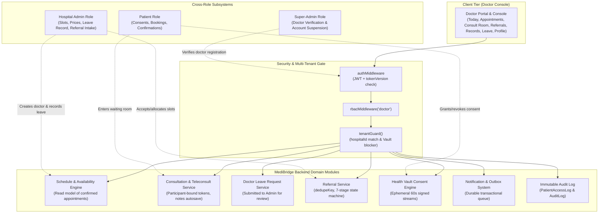

# MediBridge — Doctor Module Integration Map & Cross-Module Contract

**Date:** 23 November 2026  
**Audience:** System Architect, Security Reviewers & Engineering Team  
**Scope:** Complete verification contract connecting the Doctor Module to all 13 subsystems.

---

## 1. System Architecture Diagram



---

## 2. Cross-Module Integration Matrix (13 System Links)

| Link # | Module Link | Trigger Event | Data Exchanged | Server Check & Enforcement | Failure Behaviour | Test Name | Status |
| :---: | :--- | :--- | :--- | :--- | :--- | :--- | :---: |
| **4.1** | **Auth & RBAC** | Doctor login, token refresh, or route request | JWT `Bearer <token>`, `userId`, `role: 'doctor'`, `hospitalId`, `tokenVersion` | Verifies JWT signature, `user.isActive === true`, `decoded.tokenVersion === user.tokenVersion`, `role === 'doctor'`. | Returns 401 `AUTH_REQUIRED`, `TOKEN_EXPIRED`, or `SESSION_REVOKED`. Suspension immediately blocks access. | `tests/module1_foundation.test.js`, `tests/doctor_module.test.js` | **Done** |
| **4.2** | **Super-Admin & Verification** | Super-Admin approves or suspends doctor registration | `Doctor.verificationStatus` (`PENDING`, `VERIFIED`, `REJECTED`, `SUSPENDED`) | Verified check before appearing in search, accepting bookings, receiving referrals, or appearing in replacements. | Unverified doctors return 403 on clinical actions and are excluded from public search. | `tests/module8_portal_teleconsult.test.js`, `tests/doctor_module.test.js` | **Done** |
| **4.3** | **Hospital Admin & Tenant Isolation** | Admin provisions doctor record, schedules, leaves; Doctor accesses portal | `hospitalId`, `doctorId`, services, slots | `tenantGuard` ensures `req.user.hospitalId === target.hospitalId`. Admin cannot read doctor's consent-gated records (403 `VAULT_ACCESS_PROHIBITED`). | Foreign hospital requests return 404 `RESOURCE_NOT_FOUND`. Admin vault attempts return 403. | `tests/module2_search.test.js`, `tests/module6_vault.test.js`, `tests/doctor_module.test.js` | **Done** |
| **4.4** | **Search & Availability** | Admin publishes slots for doctor; Doctor takes leave or gets suspended | Doctor slots, next available slot, live capacity | Only verified, active doctors without overlapping leave appear in search results and slot booking. | Blocked or inactive doctors yield 0 available slots in search. Cache invalidated on leave record. | `tests/module2_search.test.js`, `tests/performance.test.js` | **Done** |
| **4.5** | **Booking & State Machine** | Patient books slot; Doctor starts and completes consultation | `Appointment` document (`doctorId`, `patientProfileId`, `status`, `version`) | Conditional status transitions: `CHECKED_IN` &rarr; `IN_CONSULTATION` &rarr; `COMPLETED`. Reject invalid transitions (e.g. `COMPLETED` &rarr; `RESCHEDULED`). | Invalid transition returns 422 `VALIDATION_FAILED`; version mismatch returns 409 `STATE_CONFLICT`. | `tests/module3_booking.test.js`, `tests/doctor_module.test.js` | **Done** |
| **4.6** | **Leave & Reassignment** | Doctor submits leave request; Admin records leave with `eventId` | `DoctorLeaveRequest`, `DoctorLeave`, overlapping appointments list | Admin records leave with unique `eventId`. Overlapping confirmed appointments flagged as `REASSIGNMENT_PENDING`. In-progress consults excluded. | Duplicate `eventId` returns 409; slot rollback on taken replacement preserves original booking. | `tests/module4_reassignment.test.js`, `tests/doctor_module.test.js` | **Done** |
| **4.7** | **Referral Engine** | Doctor creates referral for physical care or specialized treatment | `Referral` document (`referringDoctorId`, `receivingHospitalId`, `targetSpecialty`, `dedupeKey`, `clinicalSummary`) | Unique `dedupeKey` prevents duplicate submission. Receiving Hospital Admin accepts and allocates real slot atomically. | Duplicate returns existing referral with notice. Rejection computes up to 3 alternatives. | `tests/module5_referral.test.js`, `tests/doctor_module.test.js` | **Done** |
| **4.8** | **Health Vault & Consent** | Patient shares record with doctor; Doctor requests file stream | `ConsentArtifact`, `HealthRecord`, 60-second signed download token | On every file request: consent active, unexpired, unrevoked, doctor active & verified. Immutable logging in `PatientAccessLog`. | Denied requests return 403 `CONSENT_REQUIRED_OR_REVOKED`. Revocation triggers Socket.IO auto-close. | `tests/module6_vault.test.js` | **Done** |
| **4.9** | **Teleconsultation Bridge** | Doctor launches teleconsult from today's schedule | `appointmentId`, participant role (`DOCTOR`), session token | Verified participant-bound token. Waiting room state maintained until doctor enters. Consult cannot end before notes save. | Wrong participant returns 403 `JOIN_UNAUTHORIZED`. Session termination blocked if notes dirty. | `tests/module8_portal_teleconsult.test.js`, `tests/doctor_module.test.js` | **Done** |
| **4.10** | **Notifications & Outbox** | Clinical events trigger notifications; deadlines monitored | `OutboxEvent` (`eventType`, `payload`, `status`), referral response deadline | Atomic outbox write with database transaction; background worker dispatches notifications with dedupeKey. | Failed delivery retried with exponential backoff; referral deadline expiry escalates to doctor. | `tests/module3_booking.test.js`, `tests/doctor_module.test.js` | **Done** |
| **4.11** | **Audit & Observability** | Sensitive clinical actions performed by doctor | `AuditLog`, `PatientAccessLog` (action, actor, resource, ipAddress, result) | Append-only immutable collection. Structured logs include correlation ID (`X-Request-Id`). Zero PHI in logs. | Failure to audit blocks operation execution. | `tests/module6_vault.test.js`, `tests/module8_portal_teleconsult.test.js` | **Done** |
| **4.12** | **Emergency & Urgency Flagging** | Doctor flags referral or appointment as `URGENT` or `CRITICAL` | `priority: 'URGENT'`, emergency guidance links | Highlighted badges in schedule and inbox. Urgent cases present emergency guidance and direct 108 telephony. | Software never dispenses diagnosis or automated triage. | `tests/module7_emergency.test.js` | **Done** |
| **4.13** | **Reminders & Reviews (Tier 2)** | Completed appointment triggers review eligibility | `Review` document, appointment verification | Reviews allowed only after appointment reaches `COMPLETED` status. One review per visit. | Review attempt on non-completed visit rejected. | Designed for Tier 2 | **Future** |

---

## 3. Detailed Data Contract & Schemas

### 3.1 Doctor Profile Contract (`GET /api/v1/doctor/profile`)
```json
{
  "success": true,
  "data": {
    "id": "6affda3af33cb76d9e72084c",
    "name": "Dr. Sundaram Arumugam",
    "regNumber": "TNMC/2026/04812 (Demo, not verified)",
    "verificationStatus": "DEMO_NOT_VERIFIED",
    "specialty": "Cardiology",
    "qualifications": "MBBS, MD (Gen Med), DM (Cardiology)",
    "hospital": {
      "id": "6affda3af33cb76d9e72084a",
      "name": "Kovai Medical Center & Hospital (KMCH)",
      "district": "Coimbatore"
    },
    "consultModes": {
      "inPerson": true,
      "teleconsult": true
    },
    "consultationFee": 750,
    "availableDays": [1, 2, 3, 4, 5, 6]
  }
}
```

### 3.2 Doctor Leave Request Contract (`POST /api/v1/doctor/leave-requests`)
```json
// Request Body
{
  "startDate": "2026-12-01",
  "endDate": "2026-12-05",
  "reason": "Attending Indian Cardiology Summit",
  "idempotencyKey": "req_leave_sundaram_20261201"
}

// Response Body (201 Created)
{
  "success": true,
  "data": {
    "id": "6affda3af33cb76d9e72085e",
    "doctorId": "6affda3af33cb76d9e72084c",
    "hospitalId": "6affda3af33cb76d9e72084a",
    "startDate": "2026-12-01",
    "endDate": "2026-12-05",
    "reason": "Attending Indian Cardiology Summit",
    "status": "SUBMITTED",
    "createdAt": "2026-11-23T03:15:00.000Z"
  }
}
```

### 3.3 Consultation Notes Contract (`POST /api/v1/teleconsult/session/:appointmentId/notes`)
```json
// Request Body
{
  "content": "Patient reports recurrent palpitations during exertion. Blood pressure 130/85. Advised resting ECG and 2D Echocardiogram. Referral recommended to tertiary center.",
  "version": 1,
  "isDraft": false
}

// Response Body (200 OK)
{
  "success": true,
  "data": {
    "appointmentId": "6affda3af33cb76d9e720870",
    "doctorId": "6affda3af33cb76d9e72084c",
    "version": 1,
    "savedAt": "2026-11-23T03:20:00.000Z",
    "status": "COMMITTED"
  }
}
```

---

**Report Status:** Fully mapped across all 13 connections.  
**Next Action:** Awaiting user approval to proceed with Phase 2 implementation.
